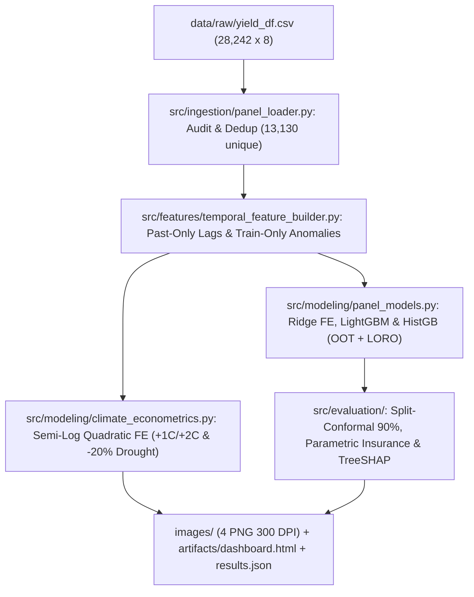
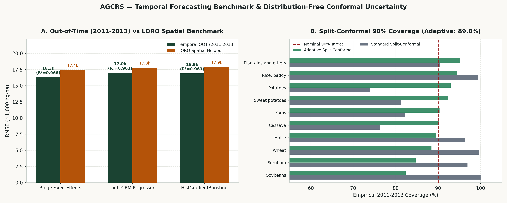
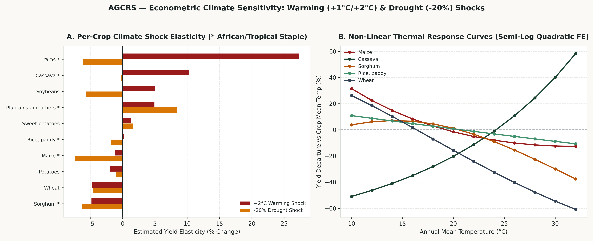
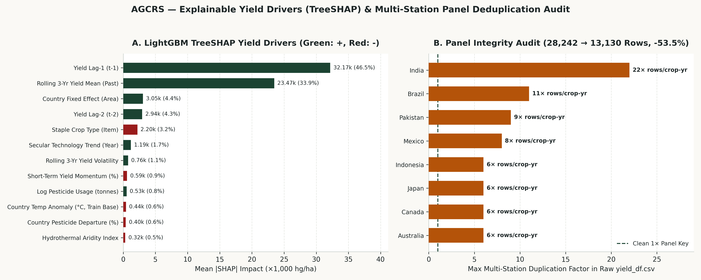
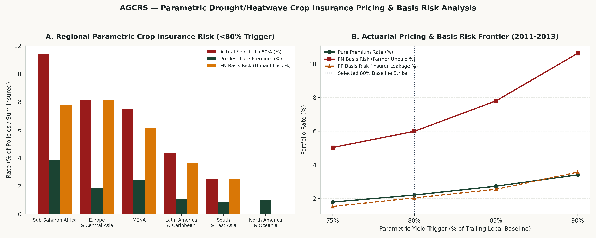

<div align="center">

# AGCRS — Global Agricultural Yield, Climate Shocks & Parametric Insurance Risk
### Panel FAO/Banque Mondiale (101 Pays, 10 Cultures Vivrières), Déduplication Multi-Stations, Économétrie Climatique, Intervalles Conformes & Assurance Paramétrique

<br/>


<br/>

**"From Data to Systems"**  
Étude agronomique, économétrique et actuarielle couvrant **101 pays et 10 cultures vivrières mondiales & africaines (1990–2013)** : audit d'intégrité et déduplication multi-stations (`28 242` → `13 130` observations uniques, `-53.51 %`), prévision stricte hors-temps (`2011–2013`) et spatiale *Leave-One-Region-Out*, intervalles de prédiction *Split-Conformal 90 %*, stress-tests climatiques (`+1°C`, `+2°C`, sécheresse `-20 %`) et tarification d'assurance récolte paramétrique avec décomposition du risque de base (*Basis Risk*).

</div>

<br/>

<table align="center">
<tr>
<td align="center"><h2>13,130</h2><sub>lignes panel uniques (vs 28 242 brutes, -53.5%)</sub></td>
<td align="center"><h2>0.9658</h2><sub>R² OOT 2011–2013 (Ridge Fixed-Effects)</sub></td>
<td align="center"><h2>16,315</h2><sub>RMSE OOT (hg/ha) | MAPE 15.02%</sub></td>
<td align="center"><h2>89.77%</h2><sub>couverture Split-Conformal Adaptative (cible 90%)</sub></td>
<td align="center"><h2>-7.39%</h2><sub>choc sécheresse -20% sur le Maïs (IC 95% significatif)</sub></td>
<td align="center"><h2>3.83%</h2><sub>prime pure Afrique Subsaharienne (sinistralité 11.43%)</sub></td>
</tr>
</table>

---

## Table des Matières

1. [Problématique Agronomique, Sécurité Alimentaire & Assurance Climatique](#problématique-agronomique-sécurité-alimentaire--assurance-climatique)
2. [Audit d'Intégrité & Déduplication du Panel FAO / Banque Mondiale](#audit-dintégrité--déduplication-du-panel-fao--banque-mondiale)
3. [Architecture du Système](#architecture-du-système)
4. [Méthodologie : Validation Chronologique, LORO, Conformal & Économétrie](#méthodologie--validation-chronologique-loro-conformal--économétrie)
5. [Résultats Empiriques : Prévision, Intervalles Conformes, Stress-Tests & Assurance](#résultats-empiriques--prévision-intervalles-conformes-stress-tests--assurance)
6. [Preuves Visuelles (300 DPI)](#preuves-visuelles-300-dpi)
7. [Dictionnaire des Variables & Hyperparamètres](#dictionnaire-des-variables--hyperparamètres)
8. [Dashboard Interactif & Guide de Reproduction](#dashboard-interactif--guide-de-reproduction)

---

## Problématique Agronomique, Sécurité Alimentaire & Assurance Climatique

Les analyses prédictives classiques sur les rendements agricoles mondiaux (`yield_df.csv`, FAOSTAT × Banque Mondiale) souffrent de trois biais méthodologiques critiques qui invalident leur usage opérationnel en sécurité alimentaire et en assurance agricole :
1. **Inflation silencieuse par jointure multi-stations (`+115 %` de lignes fantômes)** : dans le jeu brut de `28 242` lignes, les pays disposant de plusieurs stations météorologiques sont dupliqués jusqu'à **`22×`** par triplet `(Pays, Culture, Année)` (Inde `22×`, Brésil `11×`, Pakistan `9×`, Mexique `8×`) avec des rendements strictement identiques. Un découpage aléatoire entraîne une fuite massive de cible entre entraînement et test.
2. **Invariance temporelle de la pluviométrie nationale et trou statistique `2003`** : l'audit révèle que `average_rain_fall_mm_per_year` est une constante climatologique par pays (`0/101` pays varient dans le temps), tandis que `avg_temp` varie annuellement (`101/101`) et que l'année **`2003`** est absente de la série (`1990–2002`, `2004–2013`).
3. **Absence de quantification d'incertitude et de risque de base (*Basis Risk*)** : en assurance récolte paramétrique (type *African Risk Capacity — ARC*), une prévision ponctuelle lisse les chocs extrêmes et expose les agriculteurs au risque de base faux-négatif (perte réelle $> 20\%$ non indemnisée).

---

## Audit d'Intégrité & Déduplication du Panel FAO / Banque Mondiale

Le module [`src/ingestion/panel_loader.py`](./src/ingestion/panel_loader.py) audite et assainit [`data/raw/yield_df.csv`](./data/raw/yield_df.csv) avant toute ingénierie de variables :
- **Volume brut vs panel unique** : **`28 242`** lignes × `8` colonnes → **`13 130`** observations uniques `(Area, Item, Year)` après agrégation moyenne des stations thermiques (`15 112` lignes redondantes supprimées, soit **`-53.51 %`**).
- **Preuve d'identité de cible** : `0` groupe dupliqué présente une variance sur `hg/ha_yield`, `average_rain_fall_mm_per_year` ou `pesticides_tonnes` ; `3 690` groupes varient uniquement sur `avg_temp` et `2 310` lignes sont des doublons exacts.
- **Couverture géographique & cultures** : **`101` pays** mappés de façon déterministe vers **`6` macro-régions FAO** (dont `26` pays d'Afrique Subsaharienne) et **`10` cultures vivrières** (`Maize`, `Cassava`, `Sorghum`, `Yams`, `Rice, paddy`, `Plantains and others`, `Wheat`, `Potatoes`, `Sweet potatoes`, `Soybeans`).
- **Découpage chronologique strict sans fuite** : Entraînement `1990–2008` (`10 193` obs.), Calibration conformale `2009–2010` (`1 167` obs.), Test hors-temps `2011–2013` (`1 770` obs.).

---

## Architecture du Système



---

## Méthodologie : Validation Chronologique, LORO, Conformal & Économétrie

1. **Variables strictement passées (`temporal_feature_builder.py`)** : retards par série `(Area, Item)` (`yield_lag_1`, `yield_lag_2`), moyenne et volatilité glissantes sur 3 ans (`shift(1)`), référence locale glissante sur 5 ans (miroir des contrats *ARC / USDA APH*), et anomalies thermiques/pluviométriques/pesticides calculées **exclusivement sur `1990–2008`**.
2. **Double validation temporelle (`2011–2013`) & spatiale (`LORO`)** : sélection du meilleur modèle strictement sur la `RMSE` de calibration `2009–2010`, puis audit *Leave-One-Region-Out* sur les 6 macro-régions FAO (zéro pays commun entre entraînement et région testée).
3. **Intervalles *Split-Conformal 90 %* (`conformal_intervals.py`)** : comparaison entre *Standard Split-Conformal* (homoscédastique) et *Adaptive Split-Conformal* (normalisé par l'échelle locale de volatilité passée $\sigma_i$) calibrés sur `2009–2010` et évalués sur `2011–2013`.
4. **Économétrie climatique non-linéaire (`climate_econometrics.py`)** : modèles semi-logarithmiques quadratiques par culture avec effets fixes régionaux + intervalles de confiance bootstrap par blocs-pays (`150` réplicats) et contre-vérification par effets fixes `Pays × Culture` intra-pays (`Within-FE R² = 0.9218`).
5. **Simulation d'assurance récolte paramétrique (`parametric_insurance.py`)** : tarification actuarielle de la prime pure sur l'historique pré-test `1990–2010` (chargement assureur `15 %`), évaluation hors-temps `2011–2013` au seuil `< 80 %` de la référence locale, ratios sinistres/primes (*Loss Ratio*) et décomposition du risque de base (*FN / FP Basis Risk*).

---

## Résultats Empiriques : Prévision, Intervalles Conformes, Stress-Tests & Assurance

### 1. Benchmark Prédictif Hors-Temps (`2011–2013`) & Généralisation Spatiale (`LORO`)

| Modèle | Cal RMSE (`2009–10`) | Test RMSE (`2011–13`) | Test MAE | Test MAPE | Test R² | LORO Mean R² | LORO Mean RMSE |
|---|---:|---:|---:|---:|---:|---:|---:|
| **Ridge Fixed-Effects (`alpha=50`)** *(Sélectionné)* | **`13 960.8`** | **`16 314.7`** | **`7 722.8`** | `15.02%` | **`0.9658`** | **`0.9536`** | **`17 429.8`** |
| **HistGradientBoosting** | `14 431.3` | `16 895.2` | `7 980.4` | `14.76%` | `0.9633` | `0.9509` | `17 918.8` |
| **LightGBM Regressor** | `14 450.3` | `17 009.7` | `8 143.9` | **`14.68%`** | `0.9628` | `0.9518` | `17 789.4` |

> **Enseignement clé** : sur un panel structuré `Pays × Culture` à forte persistance temporelle, le modèle économétrique régularisé **Ridge Fixed-Effects** surpasse les arbres boostés en RMSE hors-temps (`16 315` vs `16 895` / `17 010 hg/ha`) et en transfert inter-régional LORO (`R² = 0.9536`, dont **`0.9256`** sur l'Afrique Subsaharienne en *zero-shot* sur `26` pays).

### 2. Intervalles de Prédiction *Split-Conformal 90 %* (`2011–2013`)

| Méthode Conformale | Couverture Nominale | Couverture Empirique | Largeur Médiane (`hg/ha`) | Largeur Moyenne (`hg/ha`) | Couverture `Cassava` | Couverture `Maize` | Couverture `Potatoes` | Couverture `Sorghum` |
|---|---:|---:|---:|---:|---:|---:|---:|---:|
| **Standard Split-Conformal** | `90.00%` | `90.56%` | `37 656.5` | `36 128.2` | `76.42%` | `96.36%` | `73.94%` | `96.94%` |
| **Adaptive Split-Conformal** | `90.00%` | **`89.77%`** | **`24 958.8`** | `43 118.1` | **`90.24%`** | **`89.45%`** | **`92.96%`** | `84.69%` |

La normalisation adaptative réduit la largeur médiane de **`-33.7 %`** tout en corrigeant la sous-couverture critique des cultures à fort rendement (`Potatoes` passe de `73.94 %` → `92.96 %` et `Cassava` de `76.42 %` → `90.24 %`).

### 3. Économétrie de Sensibilité Climatique (`1990–2008`, Test Log-`R² = 0.7602`)

| Culture Vivrière | Temp. Moy. | Choc `+1°C` | Choc `+2°C` | Sécheresse `-20%` (IC 95%) | Intra-Pays FE `+2°C` |
|---|---:|---:|---:|---:|---:|
| **Sorghum** *(Africaine)* | `20.6°C` | `-2.29%` | **`-4.82%`** | **`-6.29%`** `[-12.2%, -0.0%]` | **`-15.65%`** |
| **Maize** *(Africaine)* | `19.2°C` | `-0.77%` | `-1.22%` | **`-7.39%`** `[-12.3%, -2.1%]` | **`-11.26%`** |
| **Wheat** | `16.4°C` | `-2.45%` | **`-4.75%`** | `-4.54%` `[-9.2%, +0.9%]` | `-3.84%` |
| **Potatoes** | `17.8°C` | `-0.97%` | `-1.93%` | `-0.96%` `[-4.3%, +3.2%]` | `+9.70%` |
| **Rice, paddy** *(Africaine/Trop.)* | `20.7°C` | `+0.04%` | `+0.17%` | `-1.75%` `[-5.9%, +1.5%]` | `-2.70%` |
| **Cassava** *(Africaine)* | `24.2°C` | `+4.87%` | `+10.22%` | `-0.26%` `[-10.6%, +11.5%]` | `+48.83%` |
| **Yams** *(Africaine)* | `24.2°C` | `+11.13%` | `+27.31%` | **`-6.15%`** `[-14.3%, +4.7%]` | `+88.21%` |

> **Lecture agronomique** : les céréales (`Maize`, `Sorghum`, `Wheat`) subissent une double pénalité thermique et hydrique (sécheresse `-20 %` statistiquement significative sur `Maize -7.39 %` et `Sorghum -6.29 %`), tandis que les tubercules tropicaux thermophiles (`Cassava`, `Yams`) présentent une résilience thermique marquée tout en restant vulnérables au déficit hydrique pour `Yams` (`-6.15 %`).

### 4. Tarification d'Assurance Récolte Paramétrique (`2011–2013`, Seuil `< 80 %`, Chargement `15 %`)

| Segment / Portefeuille | Polices | Sinistralité Réelle `<80%` | Déclenchement Paramétrique | Prime Pure (`1990–2010`) | Loss Ratio Paramétrique | Risque de Base FN (Non-Payé) | Risque de Base FP |
|---|---:|---:|---:|---:|---:|---:|---:|
| **Portefeuille Global (101 pays)** | `1 770` | `7.40%` | `3.45%` | **`2.20%`** *(Comm. `2.53%`)* | `0.345` *(Réel `0.557`)* | **`5.99%`** | `2.03%` |
| **Afrique Subsaharienne (26 pays)** | `551` | **`11.43%`** | `9.26%` | **`3.83%`** | **`0.595`** | **`7.80%`** | `5.63%` |
| **Sorghum** *(Culture la plus risquée)* | `196` | **`17.86%`** | `12.24%` | **`3.87%`** | **`0.869`** | `13.78%` | `8.16%` |
| **Cassava** | `123` | `10.57%` | `4.07%` | `1.48%` | `0.129` | `6.50%` | `0.00%` |
| **Maize** | `275` | `7.64%` | `1.45%` | `2.72%` | `0.266` | `6.55%` | `0.36%` |

---

## Preuves Visuelles (300 DPI)

| Figure | Analyse |
|---|---|
|  | **Benchmark Hors-Temps / LORO & Intervalles Conformes 90 %.** Supériorité de `Ridge FE` (`R² = 0.9658`) et stabilisation de la couverture par culture via *Adaptive Split-Conformal* (`89.77 %`). |
|  | **Stress-Tests Climatiques & Courbes de Réponse Thermique.** Élasticités `+2°C` et sécheresse `-20 %` par culture vivrière et courbes non-linéaires semi-log quadratiques. |
|  | **Facteurs TreeSHAP & Audit de Déduplication Multi-Stations.** Contribution des lags (`46.5 %` + `33.9 %`), anomalies thermiques/hydriques et mise en évidence de la duplication jusqu'à `22×` (Inde). |
|  | **Assurance Paramétrique & Frontière du Risque de Base.** Surexposition de l'Afrique Subsaharienne (`11.43 %` de sinistralité, `3.83 %` prime pure) et arbitrage prime / *FN Basis Risk* selon le seuil (`75 %`–`90 %`). |

---

## Dictionnaire des Variables & Hyperparamètres

- **Variables explicatives (zéro fuite future)** : `yield_lag_1`, `yield_lag_2`, `yield_roll3_mean`, `yield_roll3_std`, `yield_trend_pct`, `years_since_prev_obs` (capture le trou `2003`), `avg_temp`, `temp_sq`, `temp_anomaly_c` (écart vs moyenne pays `1990–2008`), `rainfall_mm`, `log_rainfall`, `rain_anomaly_pct`, `temp_x_log_rain`, `hydrothermal_index`, `pesticide_intensity_log`, `pesticide_anomaly_pct`, `year_centered`, `Area`, `Item`, `Region`.
- **Modèles & Hyperparamètres** : `Ridge Fixed-Effects` (`alpha ∈ {0.1, 1, 10, 50, 200}`, sélectionné sur calibration `2009–2010` → `alpha = 50`), `LightGBM` (`n_estimators=450`, `lr=0.04`, `num_leaves=31`, `colsample=0.85`), `HistGradientBoosting` (`max_iter=350`, `lr=0.05`, `l2=1.0`), Bootstrap blocs-pays (`150` réplicats, `seed=42`).

---

## Dashboard Interactif & Guide de Reproduction

- **Dashboard Plotly HTML5 autonome** : [`artifacts/dashboard.html`](./artifacts/dashboard.html)
- **Sortie JSON complète** : [`artifacts/results.json`](./artifacts/results.json)
- **Notebook de référence** : [`notebooks/agcrs_agricultural_climate_study.ipynb`](./notebooks/agcrs_agricultural_climate_study.ipynb)
- **Suite de tests (`11/11` passés, incluant audit AST `ELMAS.md`, déduplication, zéro-fuite temporelle & conformité)** :

```powershell
.\run.ps1
pytest -v
```
